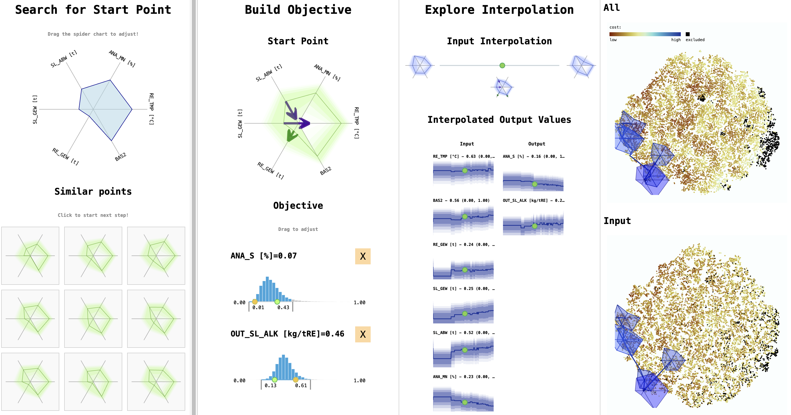

# ParamInter

[](https://doi.org/10.2312/mlvis.20261001)
[](https://doi.org/10.5281/zenodo.19886990)
[](LICENSE)

The code behind _Parameter Space Analysis through Guided Visual Interpolations_, published at EG MLVis 2026.

[Demo](https://hereditary.cgv.tugraz.at/param-inter/) · [Paper](https://doi.org/10.2312/mlvis.20261001) · [PDF](https://diglib.eg.org/bitstreams/902224d6-f79f-4995-ac27-6eb7b6ee987c/download)



> **Research use only. Not a medical device.** See [DISCLAIMER.md](DISCLAIMER.md) for intended use, data provenance and limitations.

## Overview

ParamInter is a tool to explore continuous input-output parameter sets interactively, guided by explainable AI (XAI) and uncertainty quantification (UCQ).
Users select a start sample with an editable radar chart, set up a cost function over target output values, and inspect an interpolation from the start towards the lowest-cost sample.
The interpolation is shown as small multiples of all inputs and outputs and as a path on t-SNE embeddings of the input, output and combined spaces.
LightGBM surrogates, fitted per output column, provide sensitivity hints and SHAP-based effect views; an optional VAE estimates per-column uncertainty.

An earlier version, AlloyInter, was developed for the IEEE SciVis Contest 2025 ([arXiv:2509.19202](https://arxiv.org/abs/2509.19202)).
ParamInter uses no outside service; the built frontend loads the Roboto font from Google Fonts.

## Data

No data is included in this repository. Datasets are read from `$DATA_DIR/datasets/` (default `./data/datasets/`), and fitted models are cached under `$DATA_DIR/models/`.

- **Alloy simulation data** ([IEEE SciVis Contest 2025](https://sciviscontest2025.github.io/data/), CC-BY-4.0): download `Dataset_VisContest_Rapid_Alloy_development_v3.txt` from [Zenodo](https://doi.org/10.5281/zenodo.15189444) and save it as `data/datasets/scivis/alloy_data.txt`.
- **Electric arc furnace simulation**: generated with `models/eaf/run_simulation.py`; the EAF model in `models/eaf/system_model` is refactored from [SayYoungMan/EAF_modelling](https://github.com/SayYoungMan/EAF_modelling) (MIT).
- The MAST, PrivBayes, blast-furnace and Hilti configurations in `backend/datamans/sets.py` refer to data that is not distributed with this repository.

Datasets are configured as `DataConfig` entries (`backend/datamans/config.py`): the first `input_cols` columns (after an optional leading time column) are inputs, the next `output_cols` columns are outputs.
Without `SETS_CONFIG_JSON`, the backend reads every default dataset at startup, so point it to a JSON file that lists only the datasets you have, e.g. `data/datasets/config_scivis.json`:

```json
{
    "scivis_2025": {
        "data_file": "scivis/alloy_data.txt",
        "data_name": "Alloy Simulation Data (SciVis Contest 2025)",
        "short_data_name": "scivis",
        "input_cols": 6,
        "output_cols": 64,
        "modes": ["tsne"],
        "is_config": true
    }
}
```

## Running locally

### Docker

The backend and the frontend are built as two images (as in `.gitlab-ci.yml`):

```bash
docker build -t paraminter-backend .
docker run -p 8000:8000 -v "$PWD/data:/app/data" \
    -e SETS_CONFIG_JSON=/app/data/datasets/config_scivis.json paraminter-backend

docker build -t paraminter-frontend ./frontend
docker run -p 8080:80 -e PARAM_INTER_API_BASE_URL=http://localhost:8000 \
    -e PARAM_INTER_SITE_BASE_URL= paraminter-frontend
```

Then open http://localhost:8080/.

### Development setup

Backend (Python 3.13, [uv](https://docs.astral.sh/uv/)); the index strategy is needed because of the NVIDIA package index:

```bash
uv sync --index-strategy unsafe-best-match
SETS_CONFIG_JSON=data/datasets/config_scivis.json uv run python -m uvicorn backend:app --reload --port 8091
```

Frontend (expects the API on port 8091, see `frontend/.env.development`):

```bash
cd frontend
npm i -D
npm run dev
```

Then open http://localhost:3000/param-inter/.
Environment variables: `DATA_DIR` (data directory), `SETS_CONFIG_JSON` (dataset configuration), `EMBEDDING` (`tsne`, `umap` or `pca`, used for the default configurations).

## Citation

```bibtex
@inproceedings{2026-paraminter,
	booktitle = {Machine Learning Methods in Visualisation for Big Data},
	editor    = {Archambault, Daniel and Nabney, Ian and Peltonen, Jaakko},
	title     = {{Parameter Space Analysis through Guided Visual Interpolations}},
	author    = {Kantz, Benedikt and Waldert, Peter and Lengauer, Stefan and Staudinger, Clemens and Schuster, Stefan and Schreck, Tobias},
	year      = {2026},
	publisher = {The Eurographics Association},
	isbn      = {978-3-03868-310-0},
	doi       = {10.2312/mlvis.20261001}
}
```

## Acknowledgement

<picture>
  <source media="(prefers-color-scheme: dark)" srcset="figures/funded-by-the-eu-dark.png">
  
</picture>

Funded by the European Union under grant agreement No 101137074 ([HEREDITARY](https://hereditary-project.eu/)).
Views and opinions expressed are however those of the author(s) only and do not necessarily reflect those of the European Union or the European Health and Digital Executive Agency (HaDEA).
Neither the European Union nor the granting authority can be held responsible for them.

## License

MIT, see [LICENSE](LICENSE).
